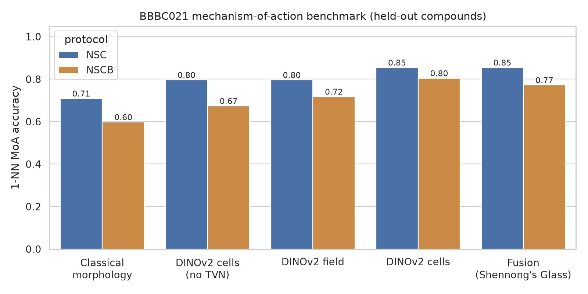

# Shennong's Glass

**Training-free foundation-model phenotypic screening with calibrated uncertainty for organ-on-chip drug evaluation**

> *Shennong (神农), the Divine Farmer of Chinese legend, tasted hundreds of herbs to tell medicine
> from poison. His body, the story goes, was transparent, so he could watch each herb act on his
> organs. An organ-on-chip is that transparent body; Shennong's Glass is the eye that watches.*

**Category: End-to-End System** · AI4S Open Innovation: AI for Life Science (5th Pazhou Algorithm Competition)

Shennong's Glass turns three-channel fluorescence images (nuclei / β-tubulin / F-actin — the standard
endpoint stains of organ-on-chip and microphysiological assays) into decision-ready readouts for
drug screening:

| Question a screening scientist asks | Shennong's Glass output |
|---|---|
| *Is this compound doing anything?* | Phenotypic activity score, calibrated against vehicle (DMSO) wells |
| *Is it just killing cells?* | Viability from automated nuclei counting, Hill-fitted dose-response |
| *How does it act?* | Mechanism-of-action (MoA) ranking with a **conformal prediction set** (guaranteed coverage) |
| *Is it something we've never seen?* | Novel-mechanism flag (similarity to the reference library) |
| *What exactly changed in the cells?* | Plain-language morphological explanation (nuclear size, microtubule texture, …) |
| *At which dose does it act vs. become toxic?* | Phenotype-vs-cytotoxicity window and triage label per compound |

Validated on **real images** from BBBC021 (MCF-7 cells, 113 compounds × 8 doses; 5,775 fields used)
with the standard *held-out-compound* protocol, and no simulated data. Results: see [Results](#results).



## How it works

```
3-channel field ─┬─ nuclei segmentation (Otsu + watershed) ─ cell territories ─ 33 interpretable features
                 ├─ 32 single-cell crops ─ DINOv2 ViT-B/14 (frozen, per channel) ─ cell embedding
                 └─ whole field          ─ DINOv2 ViT-B/14 (frozen, per channel) ─ field embedding
                                   │
              per-plate DMSO centring + Typical-Variation Normalisation (PCA-whitening on DMSO)
                                   │
        well profile ─ treatment profile (median of replicates) ─ fusion of the three views
                                   │
   ┌──────────────┬────────────────┼──────────────────┬───────────────────────┐
 MoA 1-NN     conformal sets   novelty flag     dose-response (Hill)     explanations
```

No model is trained on BBBC021 labels: the image encoder is a frozen self-supervised foundation
model, and MoA calls are nearest-neighbour look-ups in a reference library. This makes the
system usable for new chips/cell types — swap the reference library, keep the pipeline.

## Quick start

```bash
python -m venv .venv && source .venv/bin/activate
pip install torch torchvision --index-url https://download.pytorch.org/whl/cpu   # CPU is enough
pip install -r requirements.txt
kaggle auth login                     # free Kaggle account, used to fetch data
bash scripts/fetch_data.sh            # metadata, pre-extracted features, demo images
python scripts/run_analysis.py        # all metrics + figures -> results/, artifacts/
python app/app.py                     # demo at http://127.0.0.1:7860
```

To regenerate the features from raw images, run `kaggle/features/features.py` as a Kaggle
notebook (GPU T4, dataset `stanleyhua/bbbc021` attached; ~1 h). It writes `meta.parquet`,
`morph.parquet`, `emb_cell.npy`, `emb_img.npy` and `thumbs.tar`.

## Repository layout

| Path | What |
|---|---|
| `kaggle/features/features.py` | GPU feature extraction over all 13,200 BBBC021 fields |
| `shennong/extract.py` | Same extraction for a single new field (used by the app) |
| `shennong/profiles.py` | Well/treatment aggregation, DMSO-anchored normalisation (TVN) |
| `shennong/moa.py` | MoA benchmark (NSC / NSCB), conformal prediction, novelty detection |
| `shennong/dose.py` | Viability, phenotypic activity, Hill fits, cytotoxicity window, triage |
| `shennong/interpret.py` | MoA signatures and plain-language explanations |
| `scripts/run_analysis.py` | Reproduces every number and figure in the report |
| `app/app.py` | Gradio demo (4 tabs) |
| `report/` | Technical report |

## Results

All numbers come from `results/metrics.json` (5,775 real fields, held-out compounds).

| Profile | NSC | NSCB |
|---|---|---|
| Classical morphology | 70.9% | 59.8% |
| DINOv2 single cells (no TVN) | 79.6% | 67.4% |
| DINOv2 whole field + TVN | 79.6% | 71.7% |
| DINOv2 single cells + TVN | 85.4% | 80.4% |
| **Fusion (Shennong's Glass)** | **85.4%** | **77.2%** |

* **Conformal MoA sets** (target 90%): 91.3% coverage, 1.18 MoAs on average.
* **Novel-mechanism detection:** AUROC 0.79.
* **Robustness:** fused profile 84.5%–88.3% NSC across all whitening and fusion settings (`results/sensitivity_grid.csv`).
* **Dose-response:** 112 compounds triaged (`results/compound_dose_table.csv`).
* **Unannotated vinblastine** is called a microtubule destabiliser at 7/8 doses (`results/treatment_predictions.csv`).

The best published pipelines on BBBC021 report about 90–96% NSC with trained or hand-engineered profiles. Shennong's Glass uses no BBBC021 training.

## Data, licences and compliance

* **BBBC021v1** [Caie et al., *Mol. Cancer Ther.* 2010], available from the Broad Bioimage
  Benchmark Collection [Ljosa et al., *Nat. Methods* 2012]. Images and ground truth are
  copyright AstraZeneca; they are **not redistributed** here — scripts download them from the
  public sources. No human or patient data is used.
* **DINOv2** (Oquab et al., 2023), Apache-2.0, loaded from `facebookresearch/dinov2`.
* This code: MIT licence.

## Limitations

BBBC021 is a 2D MCF-7 monolayer, not an organ-on-chip. The pipeline only assumes the three
stains, which are common OoC endpoint readouts, but transfer to 3D/perfused chips (z-stacks,
mixed cell types, autofluorescent PDMS) has **not** been validated here. See the report for
the full discussion.
